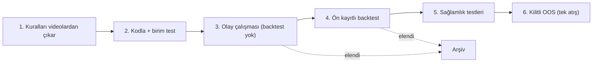

# Araştırma metodolojisi

Bu repodaki her proje aynı süreçten geçer. Amaç, bir influencer'ın anlattığı trade modelinin **anlatıldığı haliyle** gerçek veride avantaj taşıyıp taşımadığını, kendimizi kandırmadan ölçmek.

**Temel ilke:** Önce "bu davranış piyasada neden olsun?" sorusu, sonra istatistik, en son backtest. Backtest bir keşif aracı değil, sınavdır. Backtest sonucuna bakıp kural değiştirdiğin her seferde şans payı harcanır (overfitting).

## §1. Değişmez ilkeler

1. **Bağımsızlık:** Her proje kendi klasöründe, yalnızca kendi verisiyle test edilir. Bir projenin bulgusu diğerine öncül olarak taşınmaz.
2. **Kilitli OOS:** Verinin son dilimi (2026) en baştan ayrılır. Kurallar dondurulana kadar bu veriye tek bir bar bile dokunulmaz. OOS sonucu görüldükten sonra kural değiştirmek yasaktır.
3. **Sıfır sızıntı (lookahead):** Karar anında yalnızca o ana kadar tamamlanmış veri kullanılır. Bar etiketi açılış zamanıdır: 09:30 barı 09:31:00'de bilinir; sinyal bar kapanışında, işlem sonraki bar açılışında.
4. **Ekonomik mantık:** Arkasında bir mekanizma olmayan kural kabul edilmez.
5. **Tekil kârlılık:** Her model tek başına kârlı olmalı.
6. **Koda şüpheyle yaklaşma:** Her script için birim testi yazılır. Sonuç "fazla iyi" ya da "fazla kötü" görünüyorsa önce kod denetlenir.

## §2. Veri

- Ham veri değiştirilmez. Seans saatleri piyasanın yerel saatiyle (New York) tanımlanır, yaz/kış saati gözetilir.
- Vadeli kontrat roll'larından doğan yapay sıçramalar oran-ayarlı (ratio-adjusted) sürekli seriyle temizlenir.
- Eksik bar, mükerrer zaman damgası, tatil ve yarım günler kontrol edilir (Faz 0).
- **In-sample (IS):** 2020–2025, keşif ve kural kurma. **Kilitli OOS:** 2026.

## §3. Araştırma protokolü

### Aşama 1: Hipotez ve hedef
- Videolardaki kurallar mümkün olan en sade mekanik karşılığıyla yazılır. Belirsiz yerlerde birden fazla makul okuma ayrı varyant olarak kayda geçer.
- Hedef etiket (örn. olaydan sonraki 15/30/60 dk ve öğlene kadar getiri, günlük oynaklığa bölünmüş) sonuçlar görülmeden dondurulur.
- **Devam ve dönüş her zaman iki yönlü test edilir.** Hangi yönün çalışacağına önceden karar verilmez.

### Aşama 2: Öznitelikler
- Ölçekten bağımsız değişkenler (ATR'ye oran, Z-skoru, yüzdelik).
- **Sızıntı testi:** Karar anından sonraki barlar bilerek bozulur; sinyal ve özniteliklerin değişmediği birim testle kanıtlanır.

### Aşama 3: Olay çalışması (backtest yok)
Her olay × ufuk × alt küme için:
- Ortalama/medyan getiri, t-istatistiği, isabet oranı.
- Aynı saatte koşulsuz işlem açmaya göre fark (excess).
- Yıl bazında istikrar, long/short ayrımı, MFE/MAE.
- **Çoklu test düzeltmesi:** Benjamini–Hochberg FDR. Toplam test sayısı kayda geçer.
- Ağaç modeli + permutation importance (yıl dışarıda bırakmalı çapraz doğrulama). ML burada al-sat kararı vermez; yalnızca değişkenlerin bilgi taşıyıp taşımadığını ölçer.

Bu aşamada bilgi bulunamazsa normalde backtest'e geçilmez.

### Aşama 4: Şeffaf kural ve backtest
- Hayatta kalan değişkenlerle en basit kural. Eşikler nedensel hesaplanır (o güne kadar oluşmuş dağılımdan).
- **Ablation:** Her filtrenin tek başına ve birlikte katkısı ayrı gösterilir.

## §4. Backtest kuralı: SL-first
Aynı bar içinde hem stop hem hedef görülmüşse **önce stop vurulmuş sayılır.** Boşluklu açılışlarda daha kötü fiyattan çıkılır. Komisyon ve kayma her işleme eklenir.

## §5. Sağlamlık
- Ortalama, medyan ve en iyi 2 işlem çıkarılınca sonuç (üçü de pozitif olmalı).
- Koşulsuz benchmark ve rastgele yön permütasyon testi (10.000 simülasyon).
- Parametre platosu, maliyet stres testi ve başabaş maliyet.
- Kârlı yıl sayısı, long/short dengesi, en iyi günler silinince sonuç.

## §6. Çoklu enstrüman
Bir enstrümanda kurulan kural **hiç ayar yapılmadan** benzer enstrümanda (NQ → ES) çalıştırılır. Yalnızca birinde çalışan sonuç bulgu sayılmaz. Canlı hesap kısıtları (günlük stop sayısı, günlük kayıp limiti) gerekirse backtest'e kural olarak eklenir.

## §7. Kendini kandırmamak için yönetişim
- **Ön kayıt:** Başarı şartları ve varyantlar sonuçlar görülmeden `karar_gunlugu.md`'ye yazılır. Sonuç geldikten sonra şart esnetilmez.
- **Deneme sayacı:** Kaç varyant ve kaç istatistik testi yapıldığı ölçülür ve yazılır.
- **Post-hoc yasağı:** Sonuçlara bakarak bulunan "iyi görünen hücre" bulgu sayılmaz.
- **Sapma kaydı:** Protokolden her sapma (örn. olay çalışması olumsuzken backtest yapılması) gerekçesiyle kayda geçer.
