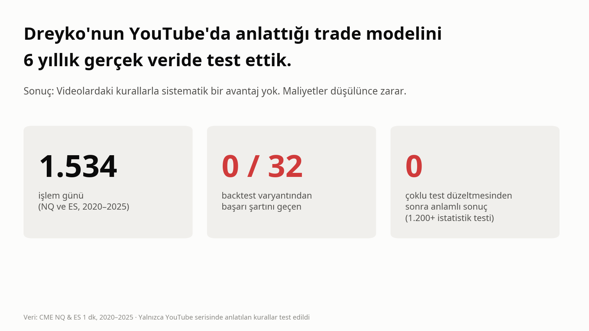
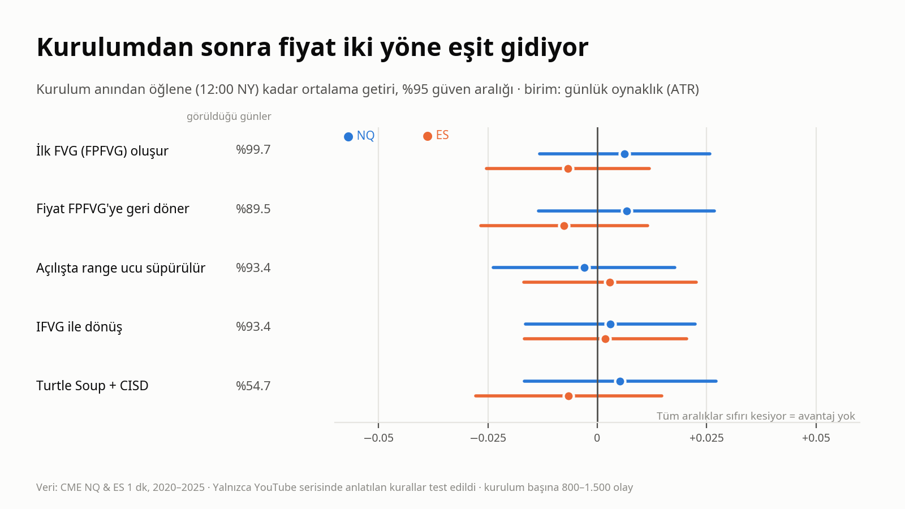
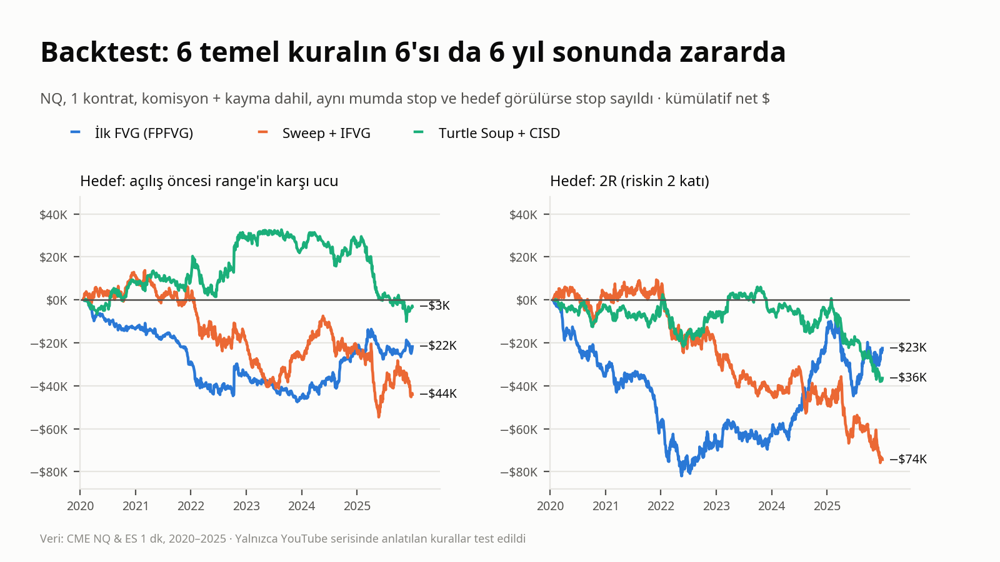

# Dreyko modeli: test sonucu

**Kısa cevap:** Dreyko'nun YouTube'da anlattığı 09:30 modeli, videolardaki kurallarla uygulandığında 2020–2025 NQ ve ES verisinde sistematik bir avantaj sağlamıyor. Kurulumlardan sonra fiyat iki yöne eşit gidiyor. Filtresiz kuralların hepsi komisyon ve kayma sonrası zararda. 32 kural varyantının hiçbiri önceden yazılmış başarı şartını geçmedi.



## İçindekiler

1. [Test edilen iddia](#1-test-edilen-iddia)
2. [Kurallar ve kaynakları](#2-kurallar-ve-kaynakları)
3. [Kod doğru çalışıyor mu?](#3-kod-doğru-çalışıyor-mu)
4. [Sonuçlar](#4-sonuçlar)
5. [Neler test edilmedi?](#5-neler-test-edilmedi)
6. [Deneme sayısı](#6-deneme-sayısı)
7. [Dosyalar](#7-dosyalar)
8. [Yeniden üretme](#8-yeniden-üretme)

## 1. Test edilen iddia

Dreyko, YouTube serilerini sıfırdan başlayan biri için bir yıl boyunca çalışılabilecek, tamamen herkese açık bir eser olarak sunuyor ([9TER4TqLcoY, 06:05–06:50](https://www.youtube.com/watch?v=9TER4TqLcoY&t=365s)). Test edilen şey bu: **Videolarda öğretilen kurallar, uygulandığında kâr ettiriyor mu?**

Dreyko'nun videolardaki kapsam beyanları da kayıtta ([R17](KURAL_KAYNAKLARI.md#r17)):
- Bazı videolarda tüm koşulları anlatmadığını ve yalnızca izlemenin yeterli olmadığını, izleyicinin günleri kendisinin çalışması gerektiğini söylüyor.
- Asia Range ve News modellerini private eğitime, bazı modellerini Telegram grubuna ayırıyor.

Bu yüzden test, videolarda **açıkça anlatılan** çekirdek modelle sınırlı: 09:30 manipülasyonu, FPFVG, IFVG, Turtle Soup + CISD, SMT, makro saatleri ve A+ seviyeleri. Private olduğu söylenen modeller test edilmedi.

Taranan 67 videonun transkriptlerinde ve izletilen 10 videoda win rate, işlem sayısı, kâr faktörü ya da maliyet verilmiyor; gösterilen performans seçilmiş tek tek günler ve payout'lardan ibaret.

## 2. Kurallar ve kaynakları

Kanaldaki 68 videonun 67'sinin transkripti tarandı. Modeli anlatan 11 video ayrıca Gemini'ye izletildi (10'u başarılı, 1'i boş döndü). Her kuralın hangi videonun hangi dakikasından alındığı: **[`KURAL_KAYNAKLARI.md`](KURAL_KAYNAKLARI.md)**.

### Dreyko'nun modeli (videolardan)

- **Piyasa:** NQ (Nasdaq vadeli), ES'yi SMT teyidi için kullanıyor. 1 dakikalık grafik, yalnızca 09:30 New York açılışından sonra.
- **Mantık:** 09:30 öncesinde likidite birikir → 09:30'da bir uç süpürülür (manipülasyon) → fiyat ters yöne döner → hedef karşı taraftaki likidite.
- **Girişler:** First Presented FVG (09:30'dan sonraki ilk 1 dk FVG) retesti, IFVG, Turtle Soup + CISD.
- **Filtreler:** NQ/ES SMT, makro saatleri (09:50–10:10), "3 şart" (key level + SMT + manipülasyon), A+ seviyeleri (Asya ve önceki gün high/low).

### Nasıl kodlandı?

| Kod | Kurulum | Giriş | Stop | Hedef |
|---|---|---|---|---|
| H1 | **FPFVG retest:** 09:30'dan sonra oluşan ilk 1 dk FVG. İki pencere: A (oluşum ≤10:00, retest ≤11:10), B (oluşum ≤09:45, retest ≤10:10) | FVG'nin yakın kenarına limit emir (kenarı 1 tick geçince dolmuş sayılır) | FVG'yi yaratan bacağın ucu + 1 tick | L: 08:00–09:30 range'inin karşı ucu · R: 2R |
| H2 | **Sweep + IFVG:** 08:00–09:30 range'inin bir ucu 09:30–10:00 arasında süpürülür, süpürme bacağındaki FVG ters kırılır | Sinyal mumunun kapanışından sonraki açılışta market | Süpürme ucu + 1 tick | L / R |
| H2b | **Sweep + Turtle Soup + CISD:** süpürmeden sonra fiyat uca ikinci kez gider (TS), sonra CISD | Sonraki açılışta market | TS ucu + 1 tick | L / R |
| Filtre | **SMT:** iki endeksten yalnız birinin açılış öncesi ucu alması · **Makro:** giriş 09:50–10:10 arası | | | |
| Filtre | **A+ seviyeleri** (seçicilik turu): Asya (20:00–00:00) ve önceki gün high/low'unun süpürülmesi, hedef seviyenin hâlâ açık olması, Asya'nın konsolide olması, "3 şart" | | | |

- Çıkış: hedef, stop ya da 12:00'de zaman çıkışı.
- Aynı mumda stop ve hedef görülürse **stop sayıldı**.
- Maliyet: NQ işlem başına 0.70 puan ($4 komisyon + taraf başına 1 tick kayma), ES 0.33 puan.
- Kurallar NQ'da kuruldu, ES'de hiç değiştirilmeden çalıştırıldı.

Videolarda sayısal karşılığı olmayan yerler (FPFVG'nin ne kadar süre geçerli olduğu, giriş emrinin türü, hedef seçimi) sonuçlar görülmeden kararlaştırıldı ve [`karar_gunlugu.md`](karar_gunlugu.md)'de gerekçesiyle kayıtlı. Birden fazla makul okuma olan yerlerde hepsi ayrı varyant olarak test edildi.

## 3. Kod doğru çalışıyor mu?

- **Videodaki işlemle karşılaştırma:** Dreyko'nun 4 Haziran 2025 ES canlı işlemi ([KDsDDr3FSP4](https://www.youtube.com/watch?v=KDsDDr3FSP4)): FPFVG'ye limit short, 09:43. Kod aynı günü aynı FPFVG'den short olarak yakalıyor (09:45 giriş, 5994.50; [`backtest/out/islemler_ES.csv`](backtest/out/islemler_ES.csv) içinde `2025-06-04`). O gün kârlı.
- **Birim testleri:** 27 test; FVG tespiti, sweep, IFVG, CISD, SL-first, boşluklu açılış, zaman çıkışı, maliyet hesabı.
- **Sızıntı testi:** Karar anından sonraki barlar bilerek bozulduğunda hiçbir sinyal ve giriş fiyatı değişmiyor.
- **Elle kontrol:** İki rastgele işlem ham barlarla birebir doğrulandı (12 Mayıs 2023 H1 short, 6 Mayıs 2021 H2 long).
- **Her işlem açık:** [`backtest/out/islemler_NQ.csv`](backtest/out/islemler_NQ.csv) ve [`islemler_ES.csv`](backtest/out/islemler_ES.csv) dosyalarında her işlemin tarihi, saati, yönü, giriş, stop, hedef ve çıkış fiyatı var. Fiyatlar o günkü kontratın gerçek fiyatıdır; kendi grafiğinizde kontrol edebilirsiniz.

## 4. Sonuçlar

Üç ayrı sınav yapıldı. Üçünde de avantaj çıkmadı.

### 4a. Olay çalışması: kurulumdan sonra fiyat nereye gidiyor?

Stop ve hedef yok. Kurulum oluştuktan sonraki 15, 30, 60 dakika ve öğlene kadar getiri, günlük oynaklığa (ATR) bölünerek ölçüldü.

| Kurulum (NQ) | Görüldüğü gün oranı | Öğlene kadar ortalama getiri (ATR) | t | Düzeltilmiş q |
|---|---|---|---|---|
| FPFVG oluşumu | %99.7 | +0.006 | 0.63 | 0.996 |
| FPFVG retest | %89.5 | +0.007 | 0.65 | 0.996 |
| Sweep (dönüş yönü) | %93.4 | −0.003 | −0.29 | 0.996 |
| IFVG | %93.4 | +0.003 | 0.29 | 0.996 |
| Turtle Soup + CISD | %54.7 | +0.005 | 0.47 | 0.996 |

- Etkiler ±0.01 ATR'nin altında (NQ'da yaklaşık ±3 puan). İsabet %48–52.
- Kurulumdan sonra fiyat iki yöne eşit gidiyor: lehte ve aleyhte en uç hareket ortalama olarak aynı (MFE ≈ MAE ≈ 0.2 ATR).
- Kurulumlar neredeyse her gün oluşuyor; yani mekanik kurallar seçici değil.
- Karar ağacı modeli yönü tahmin edemiyor (AUC 0.49–0.55, 0.50 = yazı tura).



Rapor: [`adim0/adim0_rapor.md`](adim0/adim0_rapor.md)

### 4b. Seçicilik turu: Dreyko'nun kendi filtreleri

Kurallar sonuca bakılmadan kilitlendi ([`karar_gunlugu.md`](karar_gunlugu.md), "Seçicilik turu").

| Filtre | Anlamı | Sonuç |
|---|---|---|
| F1 | Bir A+ seviyesi (Asya H/L, önceki gün H/L) 09:30'dan sonra süpürülmüş | Kurulumların %2–19'unu bırakıyor |
| F2 | Hedefteki A+ seviyesi hâlâ alınmamış | |
| F1 + F2 ("A+ kurulum", ana test) | | NQ en iyi q **0.27**, ES **0.96** → geçmedi |
| F1 + SMT ("3 şart") | | 6 yılda 9–40 olay; ölçülemeyecek kadar seyrek |

Rapor: [`adim0/secicilik_rapor.md`](adim0/secicilik_rapor.md)

### 4c. Backtest

32 varyant (3 kurulum × pencere × 2 hedef türü × SMT var/yok × makro var/yok), 1 kontrat, maliyet dahil. Filtresiz temel kurallar:

| NQ | n | İsabet | Ort. R | PF | Net $ (6 yıl) | Kârlı yıl |
|---|---|---|---|---|---|---|
| H1-A FPFVG, hedef L | 878 | %50 | −0.01 | 0.98 | −21.7K | 2/6 |
| H1-A FPFVG, 2R | 1372 | %36 | +0.01 | 1.01 | −22.5K | 3/6 |
| H2 IFVG, hedef L | 1416 | %41 | −0.02 | 0.97 | −44.0K | 4/6 |
| H2 IFVG, 2R | 1432 | %34 | −0.05 | 0.92 | −74.4K | 1/6 |
| H2b TS+CISD, hedef L | 830 | %38 | +0.06 | 1.10 | −3.1K | 4/6 |
| H2b TS+CISD, 2R | 839 | %37 | −0.01 | 0.98 | −36.4K | 2/6 |

| ES (aynı kurallar) | n | İsabet | Ort. R | PF | Net $ (6 yıl) | Kârlı yıl |
|---|---|---|---|---|---|---|
| H1-A FPFVG, hedef L | 966 | %43 | −0.12 | 0.79 | −43.2K | 0/6 |
| H1-A FPFVG, 2R | 1351 | %33 | −0.13 | 0.82 | −69.9K | 1/6 |
| H2 IFVG, hedef L | 1355 | %39 | −0.06 | 0.91 | −9.0K | 1/6 |
| H2 IFVG, 2R | 1363 | %35 | −0.05 | 0.92 | −12.7K | 1/6 |
| H2b TS+CISD, hedef L | 782 | %34 | −0.10 | 0.86 | −23.3K | 1/6 |
| H2b TS+CISD, 2R | 792 | %33 | −0.15 | 0.79 | −35.4K | 0/6 |

- **Başarı şartı** (önceden yazıldı): ortalama, medyan ve en iyi 2 işlem çıkarılınca sonuç pozitif + permütasyon q<0.05 + 6 yılın en az 4'ü kârlı + ES'de pozitif. **32 varyantın hiçbiri geçmedi.** NQ'da en küçük permütasyon q-değeri 0.72.
- **En iyi NQ varyantı** (H2 + SMT + makro, hedef L): 52 işlem, +$7.8K. Ama medyan işlem −1R (kâr birkaç büyük işlemden geliyor), permütasyon p=0.28 ve 32 varyant arasından seçilmiş en iyisi.
- **ES'de** tek pozitif köşe H1 + SMT + makro (23–47 işlem), ama aynı filtre NQ'da negatif. Tutarsız ve küçük örneklem; bulgu sayılmadı.
- "Limit emir dokunuşta dolar" (daha iyimser) varsayımı sonucu değiştirmiyor.



Rapor: [`backtest/bt_rapor.md`](backtest/bt_rapor.md) · tüm varyantlar: [`backtest/out/results_NQ.csv`](backtest/out/results_NQ.csv), [`results_ES.csv`](backtest/out/results_ES.csv)

### Neden çalışmıyor? (yorum)

1. **Kurallar seçici değil.** 1 dk FVG ve açılış öncesi range süpürmesi neredeyse her gün oluşuyor.
2. **Yön bilgisi yok.** Kurulumdan sonra fiyat iki yöne eşit gidiyor; stop/hedef ayarı bunu kâra çeviremez.
3. **Videolar seçilmiş örnekler.** Kod Dreyko'nun 4 Haziran 2025 işlemini yakalıyor ve o gün kârlı; ama 1.500 günün ortalamasında etki yok.
4. **Maliyet:** NQ'da işlem başına 0.70 puanlık maliyeti ortalama brüt kazanç karşılamıyor.

## 5. Neler test edilmedi?

- 4 saatlik / günlük FVG, order block, haftalık gap gibi **görsel olarak seçilen** key level'lar (videolarda nesnel bir seçim kuralı verilmiyor).
- Asia Range ve Lunch modelleri, haber modeli, piramit ve takdire bağlı çıkışlar.
- Dreyko'nun kişisel hesap performansı (hakkında veri yok).

Bu kısımlar videolarda test edilebilir kurallar olarak öğretilmiyorsa, "videolar sistemi öğrenmek için yeterli" iddiasını desteklemez. İspat yükü iddia sahibindedir.

## 6. Deneme sayısı

Çok sayıda test yapınca bazılarının şans eseri "anlamlı" çıkması beklenir. Bu yüzden her test sayıldı ve sonuçlar çoklu test düzeltmesinden (Benjamini–Hochberg) geçirildi.

| Aşama | NQ | ES | Toplam |
|---|---|---|---|
| Olay çalışması: ham getiri + koşulsuz baza göre fark + değişken testleri | 448 | 448 | 896 p-değeri |
| Seçicilik turu | 152 | 152 | 304 p-değeri |
| Backtest varyantı | 32 | 32 | 64 |
| Duyarlılık (limit dolumu) | 4 | | 4 |
| Karar ağacı modeli | 7 | | 7 |

**Toplam: 1.200 p-değeri + 68 backtest + 7 model.** Düzeltmeden sonra anlamlı sonuç: **0.**

2026 verisi (kilitli OOS) hiç kullanılmadı.

## 7. Dosyalar

| Dosya | İçerik |
|---|---|
| [`KURAL_KAYNAKLARI.md`](KURAL_KAYNAKLARI.md) | Her kuralın kaynağı: video, dakika, kısa alıntı |
| [`karar_gunlugu.md`](karar_gunlugu.md) | Bütün kararlar, ön kayıtlar (sonuçlardan önce yazıldı), sapmalar, deneme sayacı |
| [`model_taslak.md`](model_taslak.md) | Videolardan çıkarılan model, hipotezler, kodlanamayan kısımlar |
| [`kaynaklar/gemini_notlari.md`](kaynaklar/gemini_notlari.md) | 10 videonun Gemini analiz özetleri |
| [`kaynaklar/video_listesi.csv`](kaynaklar/video_listesi.csv) | Kanaldaki 68 video |
| [`faz0/`](faz0/) | Veri kontrolleri (eksik bar, saat dilimi, roll) ve veri yükleyici |
| [`adim0/`](adim0/) | Olay çalışması ve seçicilik turu: kod, testler, raporlar, sonuç tabloları |
| [`backtest/`](backtest/) | Backtest: kod, testler, rapor, tüm varyant sonuçları, işlem listeleri |
| [`paylasim/`](paylasim/) | Görseller ve X paylaşım metni |

## 8. Yeniden üretme

**Veri:** Databento CME Globex `ohlcv-1m`, `NQ.FUT` ve `ES.FUT`, 2020–2025. Vade geçişleri oran-ayarlı (ratio-adjusted) sürekli seriyle birleştirildi. Ham veri lisans gereği paylaşılmıyor.

Kodun beklediği dosyalar (`TRADE_DATA_DIR` altında):

```
NQ_Nasdaq/processed/nq_1m_continuous_2020_2025.parquet
ES_SP500/processed/es_1m_continuous_2020_2025.parquet
```

Faz 0 takvim kontrolü ayrıca `FX_Currencies/macro_calendars/macro_calendar_2020_2026.parquet` makro takvim dosyasını okur; olay çalışması ve backtest bu dosyayı kullanmaz.

Index `datetime_ny` (New York saati, saat dilimi bilgisi olmadan, bar açılış zamanı); kolonlar `open, high, low, close, volume, adj_factor` (ayarlı fiyat = gerçek fiyat × `adj_factor`).

```bash
export TRADE_DATA_DIR=/veri/klasoru
pytest dreyko
python dreyko/adim0/run_adim0.py
python dreyko/adim0/run_secicilik.py
python dreyko/backtest/run_bt.py
python dreyko/backtest/export_trades_csv.py
```
