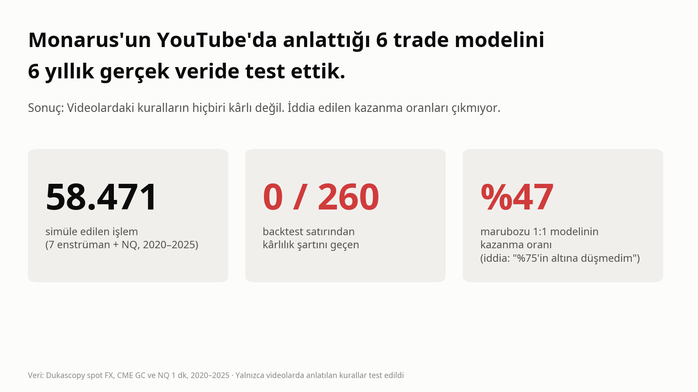
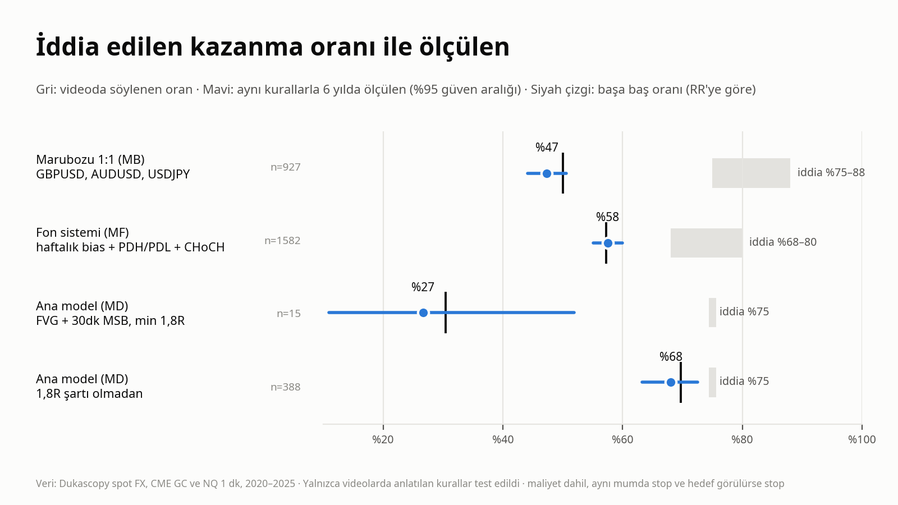
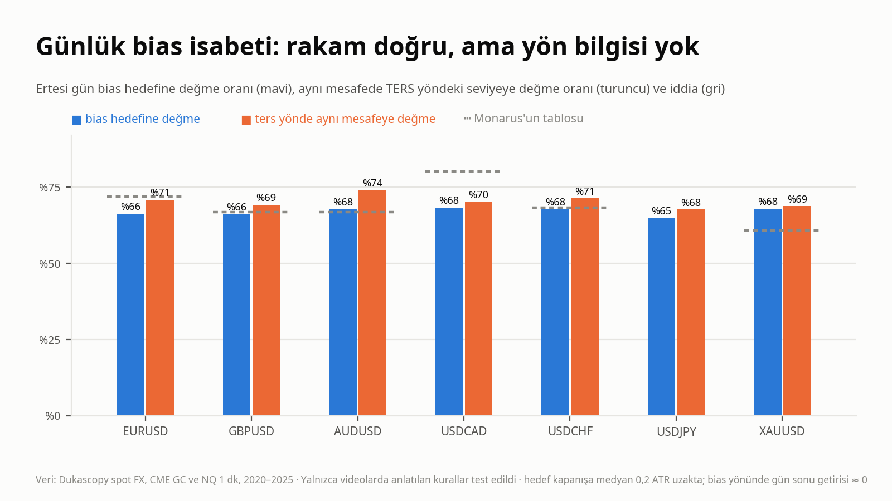
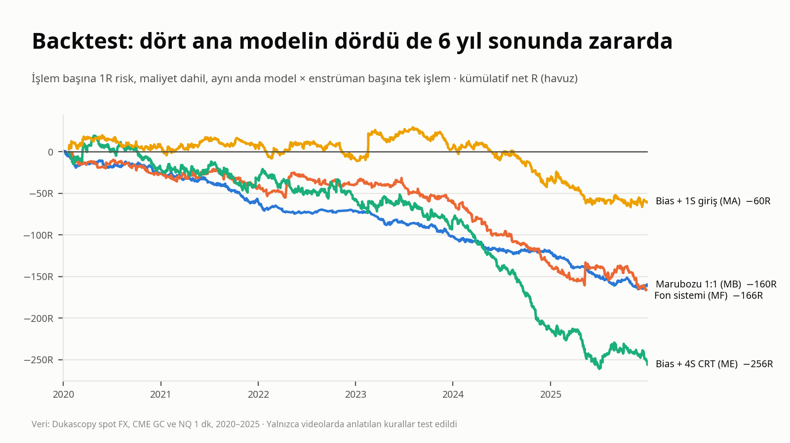

# Monarus modelleri: test sonucu

**Kısa cevap:** @TraderMonarus'un YouTube'da anlattığı altı trade modeli videolardaki kurallarla uygulandığında 2020–2025 verisinde kâr ettirmiyor. Videolarda söylenen kazanma oranları da (%68–88) bu kurallarla üretilemiyor.
- 58.471 simüle işlem üzerinde, önceden yazılmış kârlılık şartını 260 backtest satırının **hiçbiri** geçmedi.
- Günlük bias isabeti rakamı (%60–80) bu veride de çıkıyor (%64–68). Ama aynı mesafedeki ters yönlü seviyeye de aynı oranda değiliyor; yani bu oran yön bilgisi taşımıyor.



## İçindekiler

1. [Test edilen iddialar](#1-test-edilen-iddialar)
2. [Kurallar ve kaynakları](#2-kurallar-ve-kaynakları)
3. [Kod doğru çalışıyor mu?](#3-kod-doğru-çalışıyor-mu)
4. [Sonuçlar](#4-sonuçlar)
5. [Neler test edilmedi?](#5-neler-test-edilmedi)
6. [Deneme sayısı](#6-deneme-sayısı)
7. [Dosyalar](#7-dosyalar)
8. [Yeniden üretme](#8-yeniden-üretme)

## 1. Test edilen iddialar

Her iddia, kaynağıyla birlikte [`KURAL_KAYNAKLARI.md`](KURAL_KAYNAKLARI.md) ve [`karar_gunlugu.md`](karar_gunlugu.md) ("İddia kaydı") içinde.

| Model | Videoda söylenen |
|---|---|
| **MB:** 15 dk marubozu 1:1 (GBPUSD, AUDUSD, USDJPY) | Backtest'lerde %75'in altına hiç düşmediği, en yüksek %88; 17 işlemde 15 TP ([Sk5cLJuGe1E](https://www.youtube.com/watch?v=Sk5cLJuGe1E&t=69s)) |
| **MF:** "Fon sistemi" (haftalık bias + PDH/PDL sweep + 15 dk CHoCH) | Win rate %68–80, kararsız hafta filtresiyle %80–85 ([97GD3JmuKFs](https://www.youtube.com/watch?v=97GD3JmuKFs&t=959s)) |
| **MD:** Ana model (günlük/4S FVG + 30 dk sweep + kırılım, min 1,8R) | Win rate %75, ayda 6–10R; parite başı 2–3 yıllık backtest ([pchmmbx1qnU](https://www.youtube.com/watch?v=pchmmbx1qnU&t=559s), [8YMuoKYoSC4](https://www.youtube.com/watch?v=8YMuoKYoSC4&t=515s)) |
| **MA:** Günlük bias (flow / CRT) ve 1 saatlik giriş | Bias isabeti pariteye göre %60–80, "20 yıllık backtest" ([Uzd_Yo4qjr8](https://www.youtube.com/watch?v=Uzd_Yo4qjr8&t=1580s)) |
| **ME:** Bias + 4S CRT, haftalık bias + günlük CRT | Sayısal iddia yok |
| **MC:** NQ 15 dk açılış sonrası sweep, 1,5R | 2026 aylarına ait sayım. 2026 test dışı (kilitli OOS), yalnız 2020–2025 test edildi |

Test edilen şey bu iddiaların **videolarda öğretilen kurallarla** üretilip üretilemediği.

## 2. Kurallar ve kaynakları

- **Taranan içerik:** 33 içerik (22 video, 9 shorts, 2 canlı yayın). Transkriptleri tarandı; altısı ayrıca Gemini'ye izletildi ([`kaynaklar/gemini_notlari.md`](kaynaklar/gemini_notlari.md)).
- **Kural kaynakları:** Her kuralın video + dakika + alıntısı **[`KURAL_KAYNAKLARI.md`](KURAL_KAYNAKLARI.md)** içinde. Model özeti ve hipotezler [`model_taslak.md`](model_taslak.md) içinde.

| Kod | Nasıl kodlandı (özet) | Varyantlar |
|---|---|---|
| MA | D günü önceki güne göre: flow (gövde dışarıda kapanır) / CRT (uç fitille alınır, içeride kapanır) → D+1 hedefi bias mumunun ucu. MA-T: 09:00 TR sonrası %50'nin ucuz tarafı + 1S konfirme, min 1,8R, 19:00'a kadar | gün sınırı NY 17:00 / TR 00:00 |
| ME | ME-1: 04→08 ve 08→12 (TR) 4S CRT, bias yönünde, 2. mum kapanışında market, TP günlük hedef. ME-2: haftalık bias → günlük CRT → ertesi gün açılışı | ME-1n: bias'sız (kontrol) |
| MF | Haftalık kapanış önceki haftanın dışında → bias; günlük PDL/PDH sweep (≤30 pip), 15 dk CHoCH seviyesinin aşılması, stop sweep ucu, TP en yakın 15 dk likidite | MF-1k (kararsız haftada devam), MF-n (bias'sız kontrol), MF-1-atr |
| MB | 15 dk marubozu (açılış = low / high, tam eşitlik), MA üstü + internal yapı (pivot 5) + itki bacağı, açılışa limit, 10 mum içinde dolum, 08–18 TR, stop son pivot ±1,5 pip (≤20 pip), TP 1R | MB-v (SMA21; spotta hacim yok, VWMA yerine), MB-s (WMA26→SMA5), MB-h0 (filtresiz kontrol) |
| MD | Güncel ve dolmamış 4S/1G FVG (≤5 gün) → içinde 30 dk pivot fitille alınır → son 30 dk tepenin üstünde kapanış (MSB), 09–17 TR. Stop sweep ucu, TP en yakın 30 dk likidite, RR ≥ 1,8 | a: MSB kapanışında market, b: 30 dk FVG limiti; n1: RR şartı yok; n0: POI'siz |
| MC | NQ 15 dk, 09:30–13:00 NY: ≥2 mumun ucunu süpürme → CISD gövde kapanışı (A) ya da engulf + limit (B), stop sweep ucu, TP 1,5R | stop ≤ %0,5 / %1, BE (+1R'de stop girişe) |

**Ortak kurulum:**
- Aynı mumda stop ve hedef görülürse stop sayıldı.
- Maliyet dahil, gidiş-dönüş. Spot FX: EURUSD 1,0, GBPUSD 1,3, USDCAD/USDCHF 1,5, AUDUSD/USDJPY 1,3 pip. Altın $0,25. NQ 0,7 puan.
- Sonuç görülmeden kararlaştırılan her yorum [`karar_gunlugu.md`](karar_gunlugu.md)'de gerekçesiyle kayıtlı. Ön kayıtlar: [`adim0/on_kayit.md`](adim0/on_kayit.md), [`backtest/on_kayit_bt.md`](backtest/on_kayit_bt.md).

## 3. Kod doğru çalışıyor mu?

- **Birim testleri:** 53 test geçti.
  - SL-first, boşluklu açılış, dolum barı, ayna işlem, pivot, CRT, durum tablosu.
  - Sıralı işlem, BE, Wilson aralığı, drawdown, DSR.
  - Gün sınırları ve yaz saati geçişleri.
- **Sızıntı testi:** 11 model varyantı ve NQ için karar anından sonraki barlar bilerek bozuldu; kesimden önceki hiçbir olay, giriş, stop ya da hedef değişmedi.
- **Videodaki örnek ay:** Monarus'un gösterdiği Aralık 2025 AUDUSD MB işlemleri: 11 işlem, stoplar 5,9–13,8 pip.
  - Kod aynı ayda 8 işlem buluyor, stoplar 3,1–17,1 pip, 6'sı TP ([`backtest/out/islemler/islemler_MB-v.csv`](backtest/out/islemler/islemler_MB-v.csv)).
  - Videoda işlem saatleri olmadığı için birebir eşleştirme yapılamadı; veri kaynağı da farklı (FXCM / Dukascopy).
- **Her işlem açık:** [`backtest/out/islemler/`](backtest/out/islemler/) altında modele göre CSV dosyaları var. Her işlemin giriş saati (UTC ve TR), yönü, giriş/stop/hedef/çıkış fiyatı ve sonucu yazılı. Fiyatlar gerçek fiyattır (vadeli kontratlarda ayardan geri çevrildi); kendi grafiğinizde kontrol edebilirsiniz.

## 4. Sonuçlar

### 4a. İddia ile ölçülen



| İddia | Ölçülen (2020–2025, maliyet dahil) |
|---|---|
| MB: "%75'in altına düşmedim", en yüksek %88 | Kazanma oranı **%47,4** (%95 GA %44–51), 3 paritede 927 işlem, 6 yılın 6'sında zarar. 6 aylık dönemlerde en iyi %61; 17 işlemlik serilerde en iyi %76,5; %88'e hiç ulaşılmıyor |
| MF: %68–80 | **%57,5**. Hedef stoptan yakın olduğu için (RR 0,79) başabaş oranı da %57,2. Net −0,10R / işlem |
| MD: %75, ayda 6–10R | 1,8R şartıyla 7 enstrümanda 6 yılda yalnızca **15** (4S) / 24 (1G) işlem, kazanma oranı %27–29. Şart kaldırılınca %68, ama başabaş %70. Aylık R medyanı negatif; 6R ve üstü kazandıran ay yok |
| MA: bias isabeti %60–80 | %64–68, iddiayla uyumlu. Ama ters yöndeki aynı mesafeye değme oranı %68–74. Bias yönünde gün sonu getirisi ≈ 0 |

### 4b. Günlük bias isabeti neden yön bilgisi değil?



- Flow ve CRT günleri tanımı gereği ucuna yakın kapanır. Hedef kapanışa medyan 0,2 ATR uzaklıkta, karşı uç ise ~1 ATR.
- Yakın seviyeye ertesi gün değmek kolaydır. Aynı mesafede ters yöndeki seviyeye değme oranı da en az o kadar yüksek.
- "Bias hedefine %67 değme", fiyatın herhangi bir yöne 0,2 ATR gitme olasılığıdır.
- Rapor: [`adim0/adim0_rapor.md`](adim0/adim0_rapor.md) §1. Ayna kontrolü sonuç görüldükten sonra eklendi ve öyle etiketlendi.

### 4c. Backtest



| Model (havuz, gün sınırı NY 17:00) | İşlem | Kazanma oranı | Başabaş | Ort. R net | Kârlı yıl | Rastgele girişe göre p |
|---|---|---|---|---|---|---|
| MB-v (3 parite) | 927 | %47,4 | %50 | −0,17 | 0/6 | 0,94 |
| MF-1 | 1.582 | %57,5 | %57,2 | −0,10 | 1/6 | 0,40 |
| ME-1 | 2.165 | %28,3 | %37,6 | −0,12 | 0/6 | 0,31 |
| ME-2 | 764 | %27,5 | %36,9 | −0,01 | 2/6 | 0,31 |
| MA-T | 1.348 | %12,7 | %25,8 | −0,05 | 3/6 | 0,11 |
| MD-4S-a (1,8R) | 15 | %26,7 | %30,5 | −0,33 | 1/5 | 0,82 |
| MD-4S-a, RR şartsız | 388 | %68,0 | %69,7 | −0,09 | 1/6 | 0,85 |
| MC-A %1 (NQ) | 520 | %24,8 | %40 | −0,03 | 3/6 | 0,62 |

- **Kârlılık şartı** (önceden yazıldı; [`backtest/on_kayit_bt.md`](backtest/on_kayit_bt.md)): ortalama ve en iyi 2 işlem çıkarılınca sonuç pozitif + rastgele giriş permütasyonu p < 0,05 + Deflated Sharpe > 0,95 + 6 yılın en az 4'ü kârlı + başabaş maliyet ≥ 2 × maliyet. **260 satırın hiçbiri geçmedi.**
- **Bias katmanı:** Günlük/haftalık bias filtreleri hiçbir şey eklemiyor. Bias'lı ME-1 ile bias'sız ME-1n, bias'lı MF-1 ile bias'sız MF-n aynı sonucu veriyor.
- **Sorun maliyet değil:** Maliyet sıfır alınsa bile havuzlar başa baş civarında (MB −0,05R, ME-1 −0,01R, MF-1 +0,02R).
- **Pozitif tek hücreler:** Örneğin ME-2 altında +0,28R (101 işlem) var. 225 tekil hücrenin içinde şans eseri beklenecek düzeyde; hiçbiri Deflated Sharpe'tan geçmiyor.
- **Rapor ve veriler:** [`backtest/backtest_rapor.md`](backtest/backtest_rapor.md) · tüm satırlar: [`backtest/out/summary.csv`](backtest/out/summary.csv) · aylık sayım: [`backtest/out/monthly.csv`](backtest/out/monthly.csv)

### Neden çalışmıyor? (yorum)
1. **"Bias" yön bilgisi taşımıyor;** isabet rakamı mesafe asimetrisinden geliyor.
2. **Yüksek kazanma oranı küçük hedeften geliyor.** MF ve RR şartsız MD'de %58–68 kazanma oranı, başa baş noktasının hemen altında kalıyor.
3. **Filtreler seçicilik eklemiyor.** Trend, yapı, itki ve bias filtreleri filtresiz versiyonla aynı sonucu veriyor.
4. **Kısa dönemler yanıltıcı.** 6 yılda tek paritede bazı 6 aylık dönemler %75–80'e çıkabiliyor (dönemlerin %2–3'ü). Monarus'un örnek ayı bizde de %75. Aynı kurallar 6 yıla yayılınca oran %47.

## 5. Neler test edilmedi?

- **Kodlanmayan kurallar:** MB'nin FVG stop filtresi ve kâr sonrası geri çekilme işlemleri; MF'nin 2. denemesi ve %50 + BE çıkışı; ME'nin Key Level'ı; MD'nin "%20 inisiyatif", haber, DXY kesişimi ve açıklanmayan kuralları; MC'nin konsolidasyon filtresi.
- **Veri ve göstergeler:** Monarus'un kendi göstergeleri ve FXCM/OANDA verisi birebir değil. Gün ve 4S mum sınırı iki tanımla (NY 17:00, TR 00:00) denendi; sonuç değişmedi.
- **2026:** MC'nin ve MB'nin 2026'daki sayımları test edilmedi (kilitli OOS).

Bu kısımlar videolarda test edilebilir kurallar olarak verilmiyorsa, iddia edilen oranları desteklemez. İspat yükü iddia sahibindedir.

## 6. Deneme sayısı

| Aşama | Sayı |
|---|---|
| Olay çalışması (Adım 0) | 2.233 p-değeri (748 işlem anahtarı + bias isabeti + NQ rastgele giriş), Benjamini–Hochberg ile düzeltildi |
| Backtest | 260 satır × (200 tekrarlı rastgele giriş permütasyonu + Deflated Sharpe, N = 225) |

- **Düzeltme sonrası:** Adım 0'da aday 0, backtest'te kârlılık şartını geçen 0.
- **Sapmalar ve post-hoc eklemeler** [`karar_gunlugu.md`](karar_gunlugu.md)'de kayıtlı:
  - Backtest, olay çalışması olumsuzken iddia testi olarak yapıldı.
  - Bias ayna kontrolü sonuç görüldükten sonra eklendi.
- 2026 verisi kullanılmadı.

## 7. Dosyalar

| Dosya | İçerik |
|---|---|
| [`KURAL_KAYNAKLARI.md`](KURAL_KAYNAKLARI.md) | Her kuralın kaynağı: video, dakika, kısa alıntı |
| [`karar_gunlugu.md`](karar_gunlugu.md) | Bütün kararlar, iddia kaydı, ön kayıtlar, sapmalar, deneme sayacı |
| [`model_taslak.md`](model_taslak.md) | Videolardan çıkarılan modeller, hipotezler, kodlanamayan kısımlar |
| [`kaynaklar/`](kaynaklar/) | Video listesi, transkript indirme script'i, Gemini analiz özetleri ve şablonu |
| [`veri/`](veri/) | Spot FX verisini Dukascopy'den indirme ve işleme script'leri |
| [`faz0/`](faz0/) | Veri kontrolleri (bütünlük, bar zaman damgası, roll, gün sınırı, vekil kalitesi) ve yükleyici |
| [`adim0/`](adim0/) | Olay tespiti (`m_*.py`), olay çalışması, testler, ön kayıt, rapor, sonuç tabloları |
| [`backtest/`](backtest/) | Backtest kodu, testler, ön kayıt, rapor, özet tablolar, işlem listeleri |
| [`paylasim/`](paylasim/) | Görseller |

## 8. Yeniden üretme

**Veri:**
- **Spot FX:** Dukascopy BID 1 dk, ücretsiz. İndirme ve işleme: [`veri/`](veri/).
- **Vadeli:** CME GC (altın), NQ, ve Faz 0 vekil kontrolü için 6A/6J/6E/6B, Databento `ohlcv-1m`, 2020–2025. Ham vadeli veri lisans gereği paylaşılmıyor.

Kodun beklediği dosyalar (`TRADE_DATA_DIR` altında):

```
FX_Currencies/dukascopy_spot/processed/fx_dukas_{eurusd,gbpusd,usdcad,usdchf,audusd,usdjpy}_1m_processed.parquet
FX_Currencies/dukascopy_spot/raw/{audusd,usdjpy}_{2020..2025}.parquet      # yalnız çapraz kontrol testi
GC_Gold/processed/GC_1m_IS_2020_2025.parquet                                 # open/high/low/close + *_adj (fark-ayarlı)
NQ_Nasdaq/processed/nq_1m_continuous_2020_2025.parquet                       # dreyko/faz0/dreyko_data.py ile okunur
FX_Currencies/cme_futures/processed/fx_{6A,6J,6E,6B}_1m_processed.parquet   # yalnız Faz 0
FX_Currencies/macro_calendars/macro_calendar_2020_2026.parquet               # yalnız Faz 0
```

NQ yükleyicisi bu repodaki [`../dreyko/faz0/dreyko_data.py`](../dreyko/faz0/dreyko_data.py) dosyasıdır.

```bash
export TRADE_DATA_DIR=/veri/klasoru
pytest monarus
python monarus/adim0/run_adim0.py
python monarus/backtest/run_bt.py
python monarus/backtest/export_trades_csv.py
python monarus/paylasim/make_images.py
```

`pytest` komutunu monarus ve dreyko için ayrı ayrı çalıştırın; iki projede aynı adlı modüller var.
